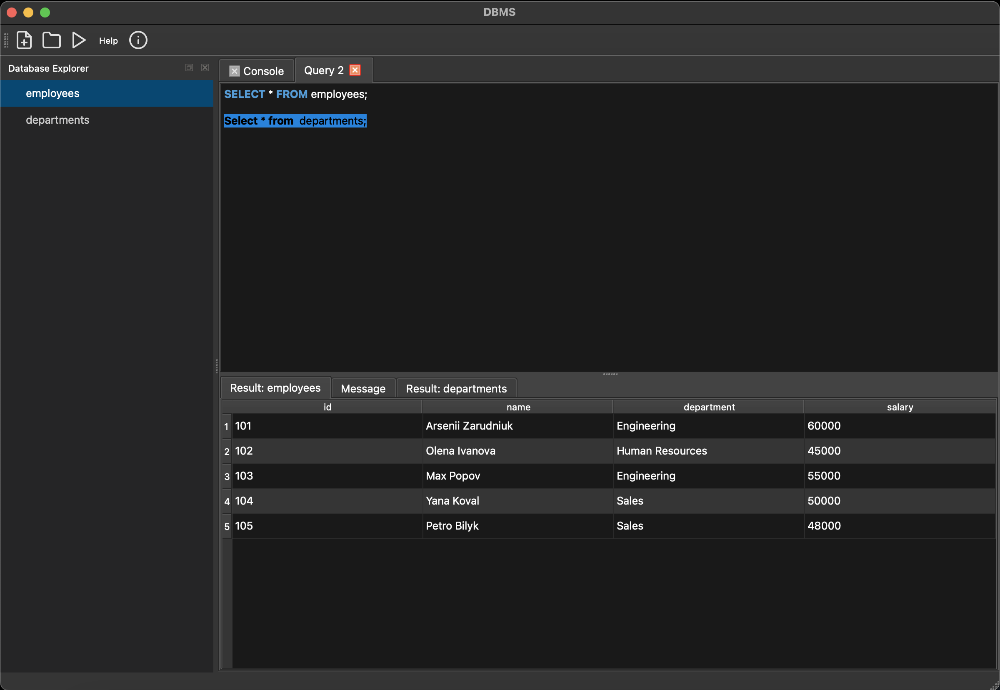

# Relational DBMS and SQL Execution Engine


An educational Relational Database Management System (RDBMS) built from scratch in modern **C++20** with an interactive desktop GUI powered by **Qt 6**. 

The goal of this project is to explore database internals "under the hood": query tokenization, finite-state machine (FSM) syntax parsing, relational query execution planning, and disk snapshot persistence.

---

## Architecture Overview

The system is decoupled into modular layers:

- **Input:** SQL Query string
- **Lexer and Parser:** Zero-regex Finite-State Machine (FSM) tokenizer and parser (`O(N)` token scan) validating grammar rules and syntax tokens
- **Query Representation:** Structured intermediate representation (`Query` command object) representing DDL, DML, or DQL commands
- **Execution Engine:** Evaluates relational queries, performing multi-condition filtering (`WHERE`), hash-based table joins (`JOIN` / `LEFT JOIN`), and hash-based aggregations (`GROUP BY` / `HAVING`)
- **Storage Layer:** Columnar in-memory table layout (`std::vector<Column>`) with file-based snapshot persistence, `PRIMARY KEY` / `FOREIGN KEY` constraint validation, and schema type management (`INTEGER`, `NVARCHAR2`, `DATE`)
- **Desktop UI:** Qt 6 graphical interface featuring `QSyntaxHighlighter`, query tabs, and table grid visualization via `QAbstractTableModel`

---

## Key Features

- **Custom SQL Engine:**
  - **DDL:** `CREATE TABLE` (with `PRIMARY KEY` uniqueness and `FOREIGN KEY REFERENCES` referential integrity checks), `DROP TABLE`.
  - **DML:** `INSERT INTO`, `UPDATE`, `DELETE` (full table or filtered via `WHERE`).
  - **DQL:** `SELECT ... FROM ... WHERE` with multi-conditional filtering (`AND`, comparison operators).
  - **Aggregations and Grouping:** Hash-based `GROUP BY`, `HAVING`, and aggregate functions (`COUNT`, `SUM`, `MIN`, `MAX`).
  - **Relationships:** Hash-based `JOIN` and `LEFT JOIN` evaluation (`O(N + M)`) between tables.
- **Desktop Database Explorer (Qt 6):**
  - Custom code editor with real-time SQL syntax highlighting (`QSyntaxHighlighter`).
  - Tabular data visualization implemented via `QAbstractTableModel`.
  - Tabbed query workspace and interactive schema explorer.
- **Robust Verification:**
  - **55+ automated unit and integration tests** using **GoogleTest** covering parser state transitions, relational joins, aggregations, key constraints, and execution results.

---

## Screenshot



---

## Tech Stack and Prerequisites

- **Language:** C++20 (GCC 11+, Clang 13+, or MSVC 2019+)
- **GUI Framework:** Qt 6.x (Core, Gui, Widgets)
- **Build System:** CMake 3.20+
- **Third-Party Libraries:**
  - `fmtlib` for modern string formatting
  - `googletest` for test automation

---

## Building and Running

### 1. Clone the repository
```bash
git clone https://github.com/arseniizar/DBMS-cpp.git
cd DBMS-cpp
```

### 2. Build via CMake
```bash
cmake -B build -DCMAKE_BUILD_TYPE=Release
cmake --build build -j
```

### 3. Run the Application
```bash
./build/DatabaseProject
```

### 4. Run Unit Tests (GoogleTest)
```bash
cd build && ctest --output-on-failure
```
